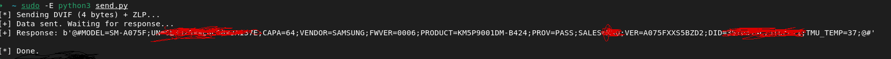

# Samsung Loke Bootloader DVIF Query Tool



A lightweight Python utility designed to interact directly with the low-level **Loke bootloader** (Download Mode) on Samsung mobile devices via raw USB control packets. 

By sending a 4-byte `DVIF` request packet followed by an explicit **Zero-Length Packet (ZLP)**, this tool satisfies the endpoint's buffer requirements and forces the bootloader to flush its factory diagnostic block in plain text.

## 🔍 Extracted Information Breakdown
The dumped string exposes several deep hardware and configuration variables:
* **`MODEL` & `CAPA`:** Exact device model variant and internal storage capacity.
* **`VER`:** Current firmware baseband/PDA string. Crucially, this exposes the **Bootloader Binary Version** (e.g., the `5` in `A075FXXS5BZD2`), which is critical for verifying firmware compatibility and preventing downgrade bricks.
* **`PRODUCT`:** The exact physical silicon part number for the on-board storage/RAM chip (e.g., Samsung uMCP component revisions).
* **`SALES`:** The active regional carrier/CSC profile.
* **`TMU_TEMP`:** Real-time SoC temperature via the Thermal Management Unit.

## ⚠️ Protocol Behavior & Limitations
* **Terminal Operations Only:** Sending the `DVIF` command places the bootloader into a strict diagnostic state. It acts as a terminal execution block—permanently locking out the standard `ODIN` flashing protocol sequence.
* **Reboot Required:** After querying data with this script, the device will reject subsequent flashing handshakes. The phone must be manually power-cycled back into Download Mode to perform standard flashing operations.

## 🚀 Installation & Usage

### 1. Install Dependencies
This tool requires `pyusb` to interface with raw USB endpoints.
```bash
pip install pyusb
```

### 2. Connect Your Device
Boot your Samsung device into Odin/Download Mode and connect it to your computer using a reliable USB cable.

### 3. Run the Script
Because this utility detaches active kernel drivers to bind directly to the raw USB interface endpoint, it must be executed with root privileges on Linux/macOS:
```bash
sudo -E python3 send.py
```

## 🤝 Community Testing
This utility was developed and verified on a **Galaxy A07 (SM-A075F)** running Bootloader Binary 5. If you test this script on other Samsung chipsets (Exynos, Snapdragon, or MediaTek), please share your findings in the issues section to help map out cross-device compatibility!

## 📜 License
This project is open-source and available under the MIT License.
